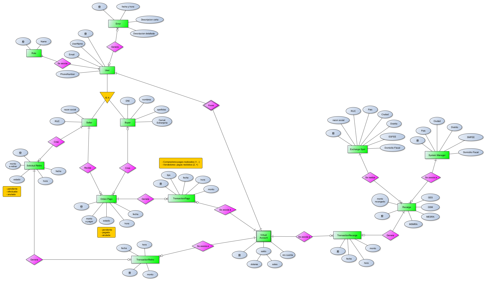
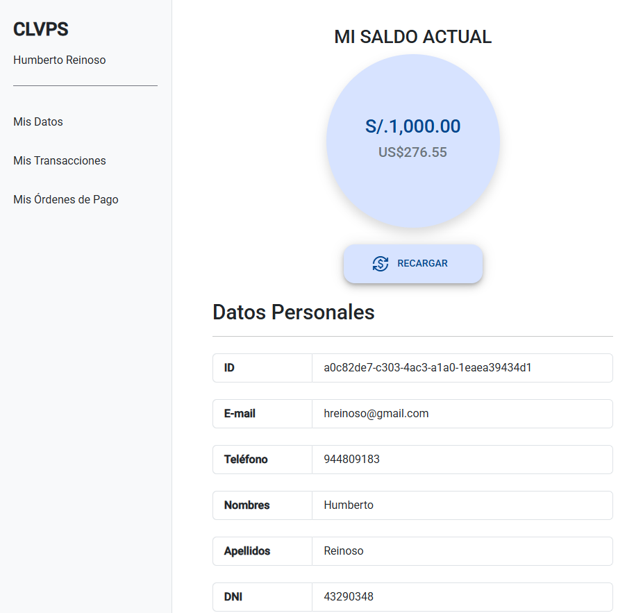
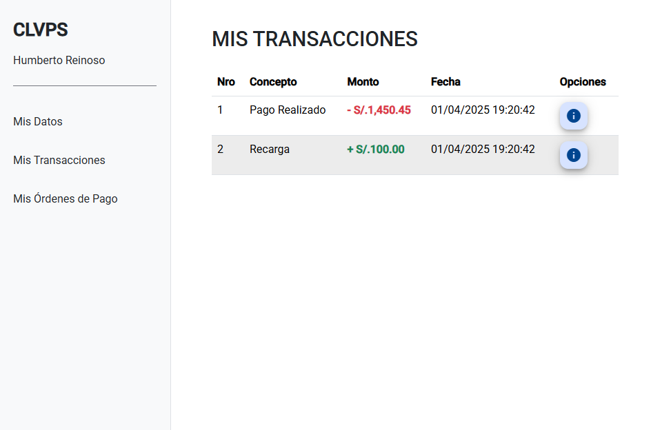
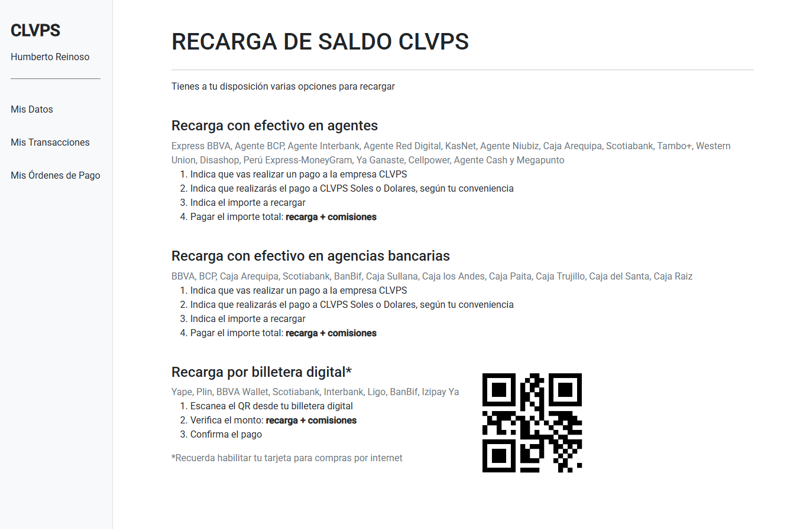
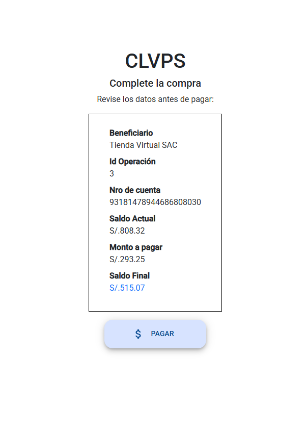
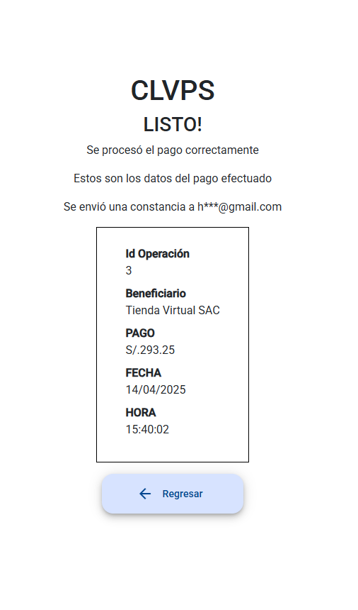

# CLVPS (CARDLESS VIRTUAL PAYMENT SYSTEM)

Prototipo de sistema de pago digital con cuenta de dinero electrónico para compradores y negocios en línea. Incluye dashboard de usuario comprador/vendedor (perfil, saldo actual, historial de transacciones, métodos de recarga), tienda virtual de prueba (catálogo de videojuegos + carrito de compras en sesión) y vista de confirmación de compra (nro operación, monto, saldo final). Dashboard desarrollado con MySQL, .NET 8.0, Entity Framework y Angular. Tienda virtual desarrollada con Java Spring Boot, Thymeleaf y mock data.

# Cómo ejecutarlo

Ejecute cada componente desde una terminal de PowerShell abierta en la raíz del repositorio. Los puertos configurados son Angular `4200`, la API `44304` y la tienda virtual `8080`.

Requisitos previos:

- Node.js y npm
- .NET 8 SDK
- Java 21
- MySQL en ejecución

## /web

Instale las dependencias y ejecute el cliente Angular:

```powershell
Set-Location .\web
npm ci
npm start
```

Después abra <http://localhost:4200>.

## /api

Antes de iniciar la API, configure en `api\clvps-prototipo-servicio\appsettings.json` una cadena de conexión válida para MySQL. Por defecto se usa la base de datos `clvps`, el usuario `root` y la contraseña `mysql`.

La API aplicará automáticamente las migraciones de Entity Framework al iniciarse. En la primera ejecución, instale y confíe el certificado de desarrollo de HTTPS:

```powershell
dotnet dev-certs https --trust
```

Luego restaure, compile y ejecútela en el puerto esperado por el cliente Angular:

```powershell
Set-Location .\api\clvps-prototipo-servicio
dotnet restore
$env:ASPNETCORE_URLS = "https://localhost:44304"
dotnet run --no-launch-profile
```

La API quedará disponible en <https://localhost:44304>.

## /tienda-virtual

La tienda usa Java 21 y el Maven Wrapper incluido, por lo que no necesita una instalación global de Maven:

```powershell
Set-Location .\tienda-virtual
.\mvnw.cmd spring-boot:run
```

Después abra <http://localhost:8080>. La tienda está configurada para comunicarse con el cliente Angular en <http://localhost:4200>.

# Screenshots












